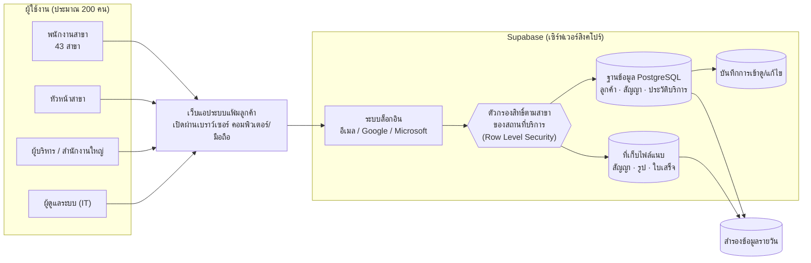
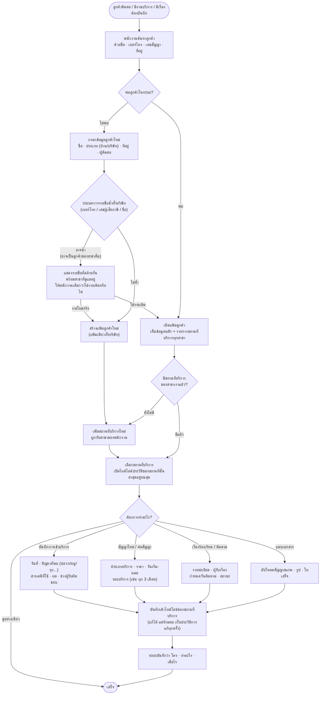
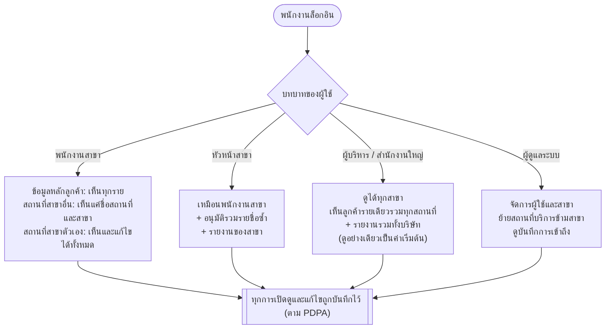
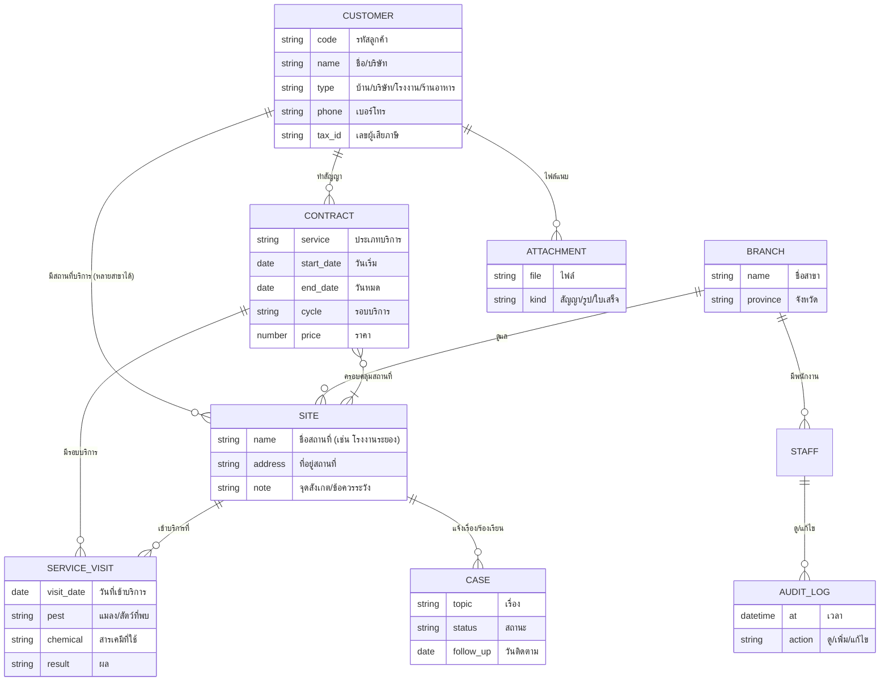
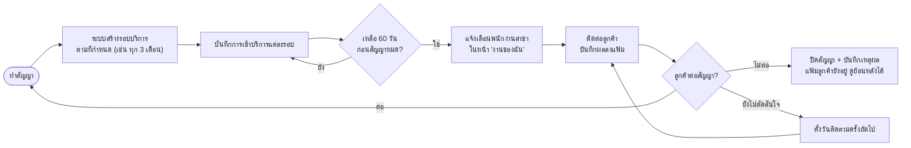
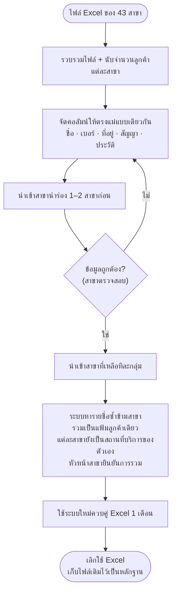
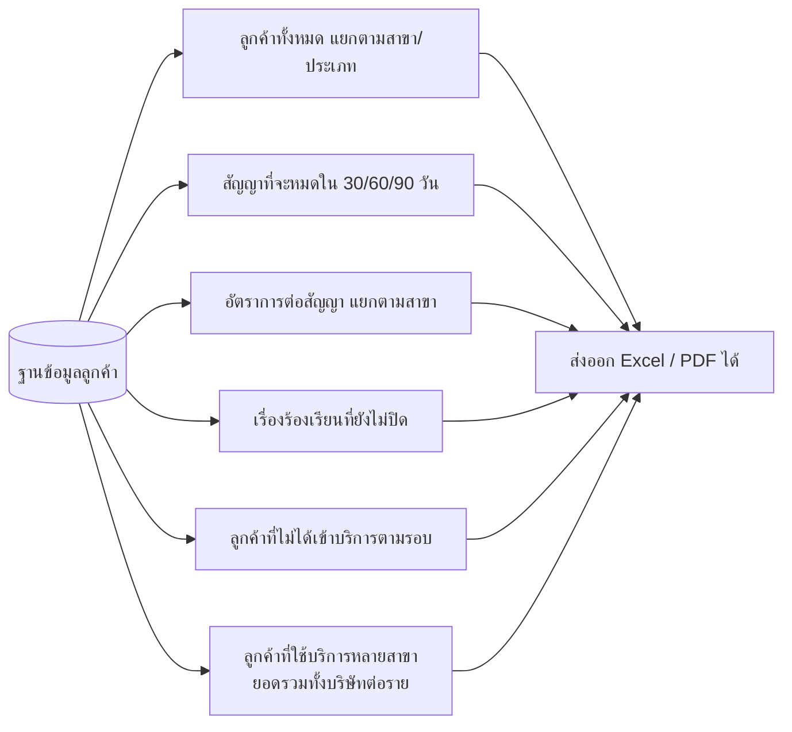

# Flow การทำงาน: ระบบแฟ้มประวัติลูกค้า แอดวานซ์กรุ๊ปเอเซีย

ร่างที่ 2 · 7 พ.ย. 2026 (ลูกค้ารายเดียวใช้บริการได้หลายสาขา) · ใช้คู่กับรายงาน `2026-11-07-advance-group-asia-backend-comparison.md`

> ส่วนที่มาจากผู้ใช้: ระบบหลังบ้านสำหรับพนักงานออฟฟิศประมาณ 200 คนจาก 43 สาขา เก็บข้อมูลและประวัติลูกค้าแบบแฟ้มประวัติคนไข้ ดูย้อนหลังออนไลน์ได้ ย้ายมาจาก Excel **ลูกค้ารายเดียวใช้บริการกับหลายสาขาได้**
> ส่วนที่ผมเสนอเอง (ยังไม่ได้ตกลงกัน): บทบาทผู้ใช้ 4 แบบ, ตรวจรายชื่อซ้ำ, ห้ามลบประวัติ, แจ้งเตือนสัญญาใกล้หมด, ขั้นตอนย้ายข้อมูลจาก Excel, การแบ่งสิทธิ์ตามสถานที่บริการ (ด้านล่าง)

### หลักการ: ลูกค้าเป็นของบริษัท สถานที่บริการเป็นของสาขา

เพราะลูกค้ารายเดียวใช้บริการได้หลายสาขา ระบบจึงแยกเป็น 2 ชั้น
- **แฟ้มลูกค้า (ชั้นบน) มีแฟ้มเดียวทั้งบริษัท:** ชื่อ เลขผู้เสียภาษี ผู้ติดต่อหลัก ทุกสาขาใช้แฟ้มเดียวกัน ไม่สร้างซ้ำ
- **สถานที่บริการ (ชั้นล่าง) ผูกกับสาขาที่ดูแล:** เช่น บริษัท ก. มีโรงงานที่ระยอง (สาขาระยองดูแล) และสำนักงานที่บางนา (สาขาบางนาดูแล)
- **ประวัติการเข้าบริการ สัญญา และเรื่องร้องเรียน** ผูกกับสถานที่บริการ จึงรู้ได้ว่าเป็นงานของสาขาไหน
- **ผมเสนอ:** พนักงานสาขาเห็นข้อมูลหลักของลูกค้า และเห็นว่าลูกค้ามีสถานที่บริการที่สาขาไหนบ้าง แต่เปิดรายละเอียดและแก้ไขได้เฉพาะสถานที่ของสาขาตัวเอง ส่วนผู้บริหารเห็นภาพรวมทุกสาขาในแฟ้มเดียว

---

## 1. ภาพรวมระบบ

ใครใช้ เข้าทางไหน และข้อมูลไปเก็บที่ใด

---

## 2. Flow งานหลัก: เปิดแฟ้มลูกค้าและบันทึกประวัติ

ใช้ทุกครั้งที่ลูกค้าโทรเข้า มีงานบริการ หรือมีเรื่องต้องบันทึก

---

## 3. สิทธิ์การเข้าถึง: ใครเห็นอะไร

---

## 4. โครงสร้างแฟ้มลูกค้า (ข้อมูลโยงกันอย่างไร)

---

## 5. รอบสัญญาและการแจ้งเตือนต่อสัญญา

---

## 6. ย้ายข้อมูลจาก Excel เข้าระบบ (ทำครั้งเดียวตอนเริ่ม)

---

## 7. รายงานสำหรับผู้บริหาร (ตัวอย่างที่ระบบควรออกได้)

---

## คำถามที่ต้องตกลงกันต่อ

1. บทบาทผู้ใช้ 4 แบบตรงกับโครงสร้างบริษัทหรือไม่
2. ~~ลูกค้ารายเดียวใช้บริการหลายสาขาได้หรือไม่~~ → **ได้** (ปรับแผนภาพแล้ว)
3. ข้อมูลในประวัติการเข้าบริการที่บริษัทต้องเก็บจริงมีอะไรบ้าง
4. แจ้งเตือนต่อสัญญาล่วงหน้ากี่วัน และแจ้งทางไหน (ในระบบ, อีเมล, LINE)
5. พนักงานสาขาควรเห็นประวัติการเข้าบริการของสาขาอื่นในลูกค้ารายเดียวกันหรือไม่ (ตอนนี้เสนอว่าไม่เห็น เห็นแค่ชื่อสถานที่และสาขา)
6. สัญญาเดียวครอบคลุมหลายสาขาได้หรือไม่ (เช่น สัญญารวมของลูกค้าที่มีหลายโรงงาน) และสาขาไหนเป็นเจ้าของสัญญา
