# Flow การทำงาน: Advance Quality System + Customer History System

ร่างที่ 5 · 8 พ.ย. 2026 (รวมระบบแฟ้มประวัติลูกค้าเข้ากับต้นแบบ Advance Quality System · สาขาและ QA เปิดงานระบาดได้)

> ส่วนที่มาจากผู้ใช้: ระบบหลังบ้านของแอดวานซ์กรุ๊ปเอเซีย 43 สาขา ผู้ใช้ประมาณ 200 คน ย้ายจาก Excel ต้นแบบคือ Advance Quality System บน Gemini (10 เมนู, บทบาท QA/QC กับพนักงานสาขา) และให้ **เพิ่ม Customer History System เข้าไปในระบบเดียวกัน** ลูกค้ารายเดียวใช้บริการได้หลายสาขา สัญญา 1 ฉบับต่อ 1 สาขา ทั้งสาขาและ QA เปิดงานแจ้งระบาด (Work) ได้
> ส่วนที่ผมเสนอเอง (ยังไม่ได้ตกลงกัน): บทบาทผู้บริหารและผู้ดูแลระบบ, ไทม์ไลน์ลูกค้าที่รวมงานจากทุกเมนู, ตรวจรายชื่อซ้ำ, ห้ามลบประวัติ, แจ้งเตือนต่อสัญญา 60 วัน, ขั้นตอนย้ายข้อมูลจาก Excel

### หลักการ: แฟ้มลูกค้าเป็นแกนกลางของทุกเมนู

ต้นแบบมีข้อมูลลูกค้ากระจายอยู่ 3 เมนู (ปัญหาระบาด, Quality Checklist, ความพึงพอใจ) ระบบใหม่จะให้ทุกเมนูอ้างถึง **สถานที่บริการของลูกค้า** ตัวเดียวกัน
- **แฟ้มลูกค้ามีแฟ้มเดียวทั้งบริษัท** สถานที่บริการแต่ละแห่งผูกกับสาขาที่ดูแล และสัญญา 1 ฉบับผูกกับสถานที่ 1 แห่ง
- **เปิดแฟ้มลูกค้าแล้วเห็นไทม์ไลน์รวม** ทั้งการเข้าบริการ สัญญา งานระบาด ผล Quality Checklist คะแนนความพึงพอใจ และเรื่องร้องเรียน เหมือนแฟ้มคนไข้
- **งานในเมนูอื่นเลือกลูกค้าจากแฟ้ม** ไม่พิมพ์ชื่อลูกค้าเอง ข้อมูลจึงไม่ซ้ำและไม่สะกดผิด

---

## 1. ภาพรวมระบบ

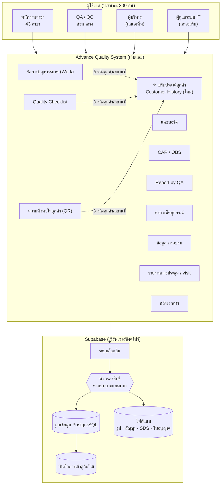

---

## 2. บทบาทและสิทธิ์

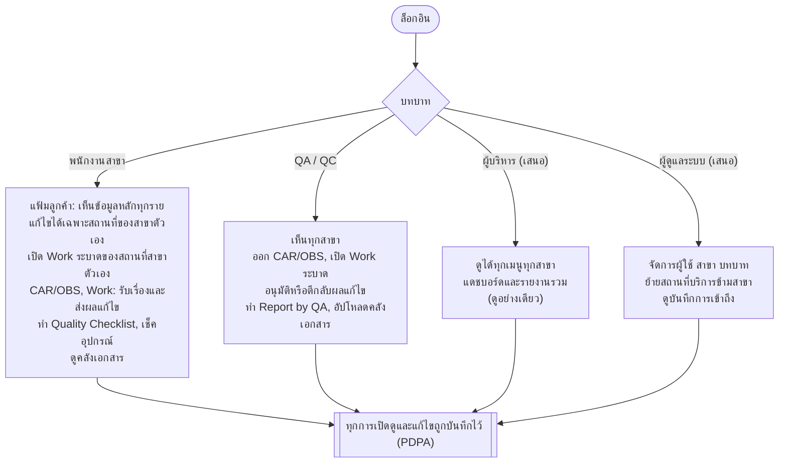

---

## 3. แฟ้มประวัติลูกค้า (Customer History): เปิดแฟ้มและบันทึก

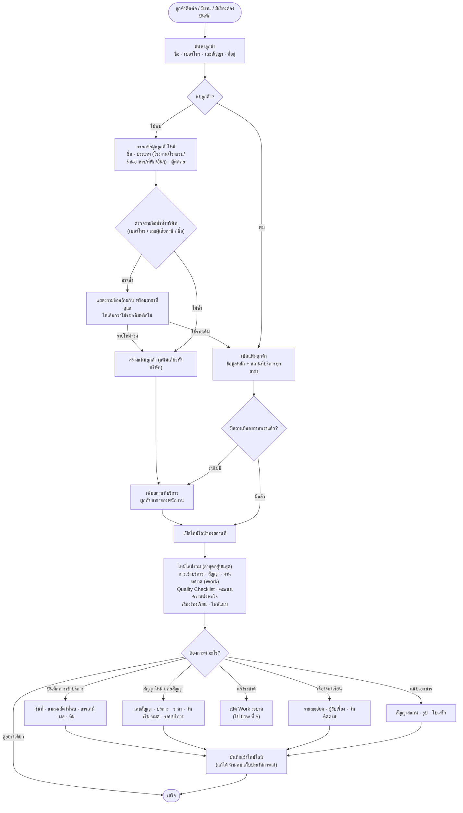

---

## 4. CAR / OBS (จากต้นแบบ)

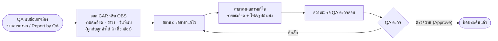

---

## 5. จัดการปัญหาระบาด (Work) และการเชื่อมกับแฟ้มลูกค้า

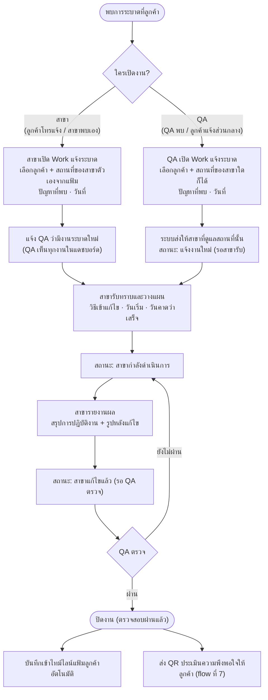

---

## 6. ตรวจมาตรฐาน: Quality Checklist และ Report by QA

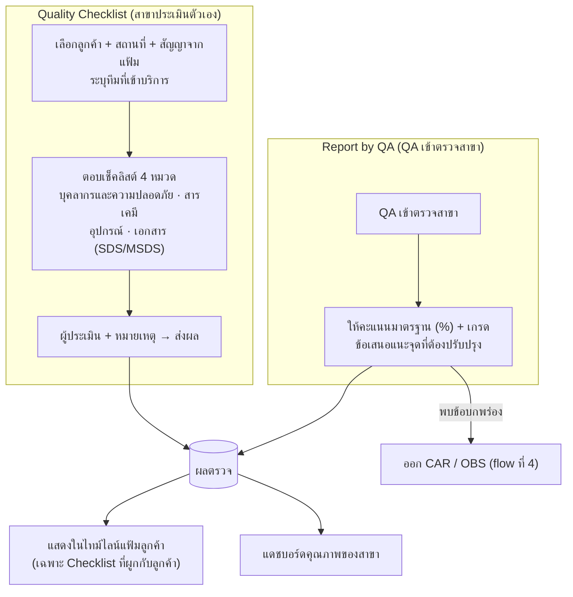

---

## 7. ความพึงพอใจลูกค้า (QR)

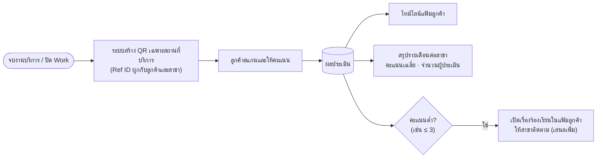

---

## 8. งานประจำของสาขาและส่วนกลาง (จากต้นแบบ)

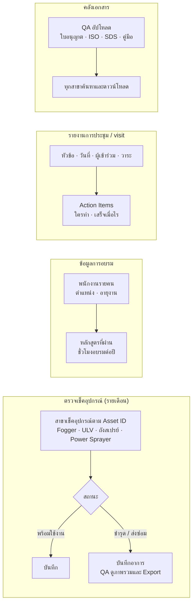

---

## 9. โครงสร้างข้อมูลรวม

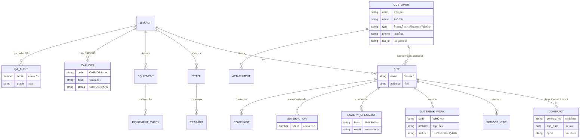

---

## 10. รอบสัญญาและการแจ้งเตือนต่อสัญญา

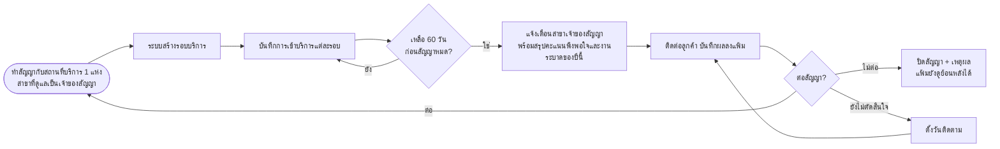

---

## 11. ย้ายข้อมูลจาก Excel (ทำครั้งเดียวตอนเริ่ม)

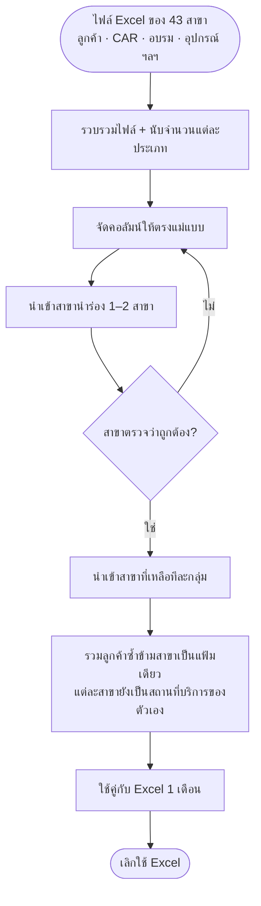

---

## 12. แดชบอร์ดและรายงาน

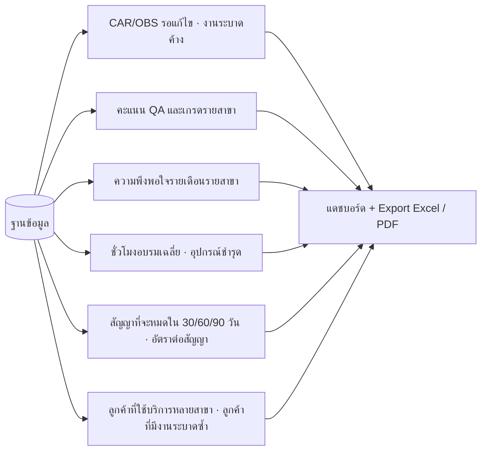

---

## คำถามที่ต้องตกลงกันต่อ

1. ต้องมีบทบาทผู้บริหารและผู้ดูแลระบบเพิ่มจาก QA/QC กับพนักงานสาขาหรือไม่
2. พนักงานสาขาเห็นประวัติของสาขาอื่นในลูกค้ารายเดียวกันได้หรือไม่ (ตอนนี้เสนอว่าไม่ได้)
3. ~~ใครเปิด Work ระบาดได้บ้าง~~ → **สาขาและ QA** (ปรับ flow ที่ 5 แล้ว: สาขาเปิดได้เฉพาะสถานที่ของตัวเอง ส่วน QA เปิดได้ทุกสาขา)
4. CAR/OBS ต้องผูกกับลูกค้าเสมอ หรือเป็นเรื่องภายในสาขาเป็นหลัก
5. ข้อมูลการเข้าบริการที่ต้องเก็บจริงมีอะไรบ้าง
6. แจ้งเตือนผ่านช่องทางไหน (ในระบบ, อีเมล, LINE)
